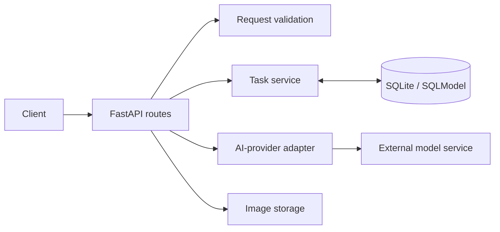

# AI Image Generation Backend

A Python backend prototype for submitting image-generation requests, tracking their status, and managing image records. The project demonstrates API design and separation between request handling, application services, validation, and persistence.

**Stack:** FastAPI · SQLModel · SQLite · Pydantic · Python

## Implemented structure

- **API layer:** prompt submission, task listing and lookup, task deletion, image access, health, and status routes.
- **Service layer:** task lifecycle operations, an external AI-provider adapter, and image-storage helpers.
- **Data layer:** SQLModel records and database-session helpers.
- **Validation:** Pydantic request and response schemas with prompt and image-size constraints.
- **Application plumbing:** request identifiers, timing logs, exception handlers, configuration, and development CORS settings.



## Repository layout

```text
api/          Application entry point, routes, and dependencies
services/     AI-provider, image, and task services
schema/       Request and response schemas
db/           Models and session management
infra/        Configuration and logging
library/      Shared helpers
run/          Command-line utility
static/       Local image storage
```

## API routes

| Method | Path | Purpose |
| --- | --- | --- |
| POST | `/api/generate` | Submit a generation request |
| GET | `/api/tasks` | List tasks |
| GET | `/api/tasks/{task_id}` | Inspect a task |
| DELETE | `/api/tasks/{task_id}` | Delete a task |
| GET | `/api/images/{filename}` | Retrieve an image |
| DELETE | `/api/images/{filename}` | Delete an image |
| GET | `/api/status` | Inspect service status |
| GET | `/api/health` | Health endpoint |

Example request body:

```json
{
  "prompt": "A small cabin beside a lake at sunrise",
  "width": 512,
  "height": 512,
  "style": "illustration"
}
```

## Development setup

Use a virtual environment and install the dependencies listed in `requirements.txt`. Copy `.env.example` to `.env` and supply your own provider credentials. Keep `.env`, generated images, databases, and logs outside version control.

The intended application entry point is `api.main:app`:

```bash
python -m uvicorn api.main:app --host 127.0.0.1 --port 8000
```

**Current snapshot:** this repository is a development prototype and still needs the integration fixes below before this startup command and the complete generation flow can be relied on.

## Current limitations

- `api/main.py` refers to `config.server`, while the configuration object exposes server-related values through `config.app`.
- The implementation imports `requests`, but the dependency is absent from `requirements.txt`.
- The AI response parser currently constructs an example image URL. Its request and response handling need to be aligned with the chosen provider's actual image-generation API.
- The fallback path writes placeholder text to a `.jpg` path; it does not generate a valid image.
- Authentication is a development stub. Background tasks run in the application process rather than a durable external queue.

The main value of this snapshot is its layered backend structure and task-management workflow. The notes above distinguish those implemented components from the remaining integration work.

## Author

Xintong Zhou · HKUST Computer Science

[GitHub](https://github.com/Zn-Cu1207) · [Email](mailto:xzhoucp@connect.ust.hk)
